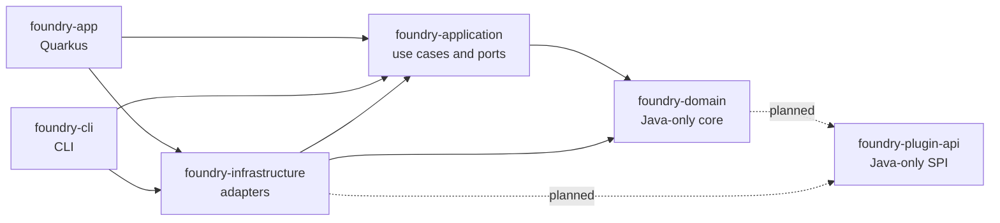
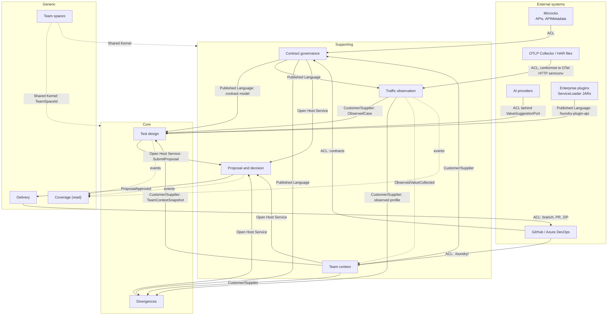

# Architecture

Microcks Foundry follows Clean Architecture and Domain-Driven Design. The domain and use cases form a Java-only core; adapters and entry points depend inward, never the other way around.

This document has two parts:

- **Current state.** What the build enforces today: modules, dependency direction, and build baseline.
- **Target domain model.** Subdomains, bounded contexts, aggregates, commands, queries, events, and extension points derived from [docs/PRD.md](docs/PRD.md).

The domain model is a design proposal and adds no requirement. Every element cites the PRD requirement (`E1.x`…`E5.x`) or section (`§`) it serves; the PRD prevails if they disagree. Code names (aggregates, commands, queries, events) are in English; the PRD glossary (§5) remains the reference for terms.

## Modules

| Module | Responsibility | Allowed dependencies |
| --- | --- | --- |
| `foundry-domain` | Domain model, rules, and algorithms | Java platform only; `foundry-plugin-api` once it exists |
| `foundry-application` | Use cases and ports | `foundry-domain` |
| `foundry-infrastructure` | Adapters for external systems and persistence | `foundry-application`, `foundry-domain` |
| `foundry-app` | Quarkus entry point and composition root | `foundry-application`, `foundry-infrastructure` |
| `foundry-cli` | CLI entry point and composition root | `foundry-application`, `foundry-infrastructure` |
| `foundry-plugin-api` (planned) | Public extension contract for enterprise algorithms (§8) | Java platform only |



The `foundry-app` and `foundry-cli` modules are composition roots. The CLI module is scaffolding until its command-line behavior is implemented.

Bounded contexts are **packages inside these layer modules**, not separate Maven modules: one team ships one deployable, and ArchUnit protects the context boundaries. A context becomes its own module only for a concrete reason, for example if Microcks v2 embeds the test design core as a library (§14).

## Enforced boundaries

ArchUnit tests in `foundry-app` verify that:

- the domain does not depend on application, infrastructure, either entry point, or Quarkus;
- application code does not depend on infrastructure, either entry point, or Quarkus;
- infrastructure does not depend on either entry point.

The test imports the domain, application, and infrastructure packages only; `foundry-app` has no dependency on `foundry-cli`, so CLI classes are not checked yet.

The rules run as part of `mvn verify` and are included in GitHub Actions pull request checks. The rules planned for the domain model are listed in [Planned architecture rules](#planned-architecture-rules); they are not enforced until they are added to `ArchitectureTest`.

## Test organization

Tests stay in their Maven modules under `src/test/java`; resources stay under `src/test/resources`.
Surefire runs unit tests named `*Test`, and Failsafe runs integration tests named `*IT` during `mvn verify`.
Unit tests cover domain and application behavior. Integration tests exercise adapters and the API composition,
including the domain and application they compose.

Executable Gherkin belongs to `foundry-application/src/test/resources/feature/<name>/`.
Its Java bindings belong to `foundry-application/src/test/java/io/microcks/foundry/application/feature/<name>/`.
The Cucumber runner reads the whole `feature` resource folder and binding package. Cucumber and JUnit are test-scoped
dependencies, not dependencies of the Java-only production core.

PIT runs from `foundry-application`, mutating domain and application classes with tests from both modules.
It reuses unchanged results through a local history file. The mutation script invalidates that history when test
resources or core Maven configuration change, since PIT does not hash Gherkin resources itself.
Adapter and API mutations are not part of this core mutation gate.

The `diagnostic` classes, tests and Gherkin are temporary probes for the initial test and mutation setup, not product
features. Replace them with real behavior and its tests before removing the probes; an empty mutation run must fail.

## Build baseline

- JDK and Java release: 21, configured by `maven.compiler.release` in the root `pom.xml` and matched by CI.
- Quarkus: `3.20.3`, configured once as `quarkus.platform.version` and used for both the platform BOM and Maven plugin.
- CI runner: `ubuntu-latest` Linux x86_64; the native job produces an executable for that runner architecture.
- Local native builds use the architecture of the container builder. Other operating systems and CPU architectures are not yet CI-supported.

See [CONTRIBUTING.md](CONTRIBUTING.md) for the build and validation commands and for where new code belongs.

---

## Domain model

### Guiding decisions

1. **The team's git repository is the source of truth** for contracts, APIExamples, Arazzo files, and `.foundry/` (§10, E1.5, E4.2). Foundry owns only what it must remember between requests: proposals and their decisions, deliveries, divergences, observed traffic, learned values, and team spaces. Aggregates exist only there.
2. **Test design is a deterministic, pure domain**: `(contract, Gherkin, team context, options, seed, algorithm catalog) → artifacts` (E1.7, §11 Reproducibility). It has no persistent aggregate; its rules live in value objects and domain services named after the algorithm catalog (§8). It is rich, not anemic: the rules are in the domain, without mutable state.
3. **Every output goes through one aggregate, `Proposal`** (E1.5, E1.10, E1.13): generation, contract audit, divergence fix, and memory promotion all end as a reviewed proposal.
4. **No Event Sourcing.** Reproducibility comes from pure functions and a `GenerationManifest` that pins every input; the decision journal is an append-only log, not a source for rebuilding state.
5. **CQRS only where a separate read model pays off** (cross-context dashboards, coverage, decision queue). Elsewhere a query reads the aggregate repository.
6. **One transaction changes one aggregate.** Cross-aggregate effects are eventually consistent through domain events; T1 dispatches them synchronously in the application layer, and an outbox is introduced only when work becomes asynchronous (T2 traffic queue, §11 Scalability).

### Subdomains

| Subdomain | Type | Why | Requirements |
| --- | --- | --- | --- |
| Test design (examples and Arazzo workflows) | Core | The reason the product exists: named ISTQB techniques, value resolution, Gherkin → example traceability, cross-operation consistency | E1.2–E1.4, E1.7, E1.8, E1.12, E1.16, E1.17, E2.14, E2.15, E3.1–E3.5, E3.8, §8, §9 |
| Contract / traffic divergences | Core | The arbitration "contract is late" versus "implementation is suspect" is specific to Foundry | E2.6, E2.9–E2.11 |
| Proposal and human decision | Supporting | Principle 1 is non-negotiable, but review and diff mechanics do not differentiate the product | E1.5, E1.10, E1.13, E1.20, E4.3, E4.4, E5.1 |
| Traffic observation | Supporting | Turns OTLP and HAR into exchanges, deduplicated cases and path templates for the core | E2.1–E2.5, E2.7, E2.8, E2.12, E2.16, E2.17 |
| Contract governance | Supporting | Audit, compatibility, and minimal patch serve proposals | E1.9, E1.14, E1.15, E1.18, E1.19, E2.4, E2.13, E3.7 |
| Team context | Supporting | Dictionaries, memory, rules, and skills make each team's output different | E4.1, E4.2, E4.7, E5.3, §10 |
| Delivery | Generic | Git forge and archive integration | E1.5, E1.20 |
| Team spaces and administration | Generic | Isolation, export tokens, enabled AI providers | §11 Isolation, E2.7, E4.5, H12 |
| AI assistance | Generic | Replaceable engines behind one port; never required | E4.5, §14 |
| Coverage | Generic, read-only | Projections over facts of other contexts | E1.6, E2.18, E3.5, E5.2 |

### Bounded contexts

Contexts follow language and invariants, not screens (§19).

| Context | Package | Type | Aggregates | Own terms | First slice |
| --- | --- | --- | --- | --- | --- |
| Test design | `design` | Core | None: domain services and value objects | Technique, example, negative example, value origin, resolution chain, seed, generation manifest, workflow, step, link, state transition | T1 (examples), T3 (workflows) |
| Divergences | `divergence` | Core | `Divergence` | Divergence, field difference, breaking, call ratio, evidence, verdict, handling mode | T2 |
| Proposal and decision | `proposal` | Supporting | `Proposal` | Proposal, revision, file change, reason, review item, decision, automatic decision, pre-delivery check, approved snapshot | T1 |
| Traffic observation | `traffic` | Supporting | `PathTemplateSet` | Exchange, flow, binding, path template, observed case, unbound traffic | T2 |
| Contract governance | `contract` | Supporting | `ManagedApi` | Contract revision, primary and secondary source, audit finding, rule level, breaking change, minimal patch | T1 |
| Team context | `teamcontext` | Supporting | `MemoryCandidate` (T4, depends on H1) | Dictionary, memory, learned value, promotion, team rule, skill, context snapshot | T1 (read-only snapshot) |
| Delivery | `delivery` | Generic | `Delivery` | Channel (GitHub PR, Azure DevOps PR, ZIP), branch, archive | T1 |
| Team spaces | `space` | Generic | `TeamSpace`; `AiProviderCatalog` (T4) | Team space, export token, enabled AI provider, retention | T1 (minimal) |
| Coverage | `coverage` | Generic | None: projections | Coverage by operation, by technique, by transition | T1 (CLI report), T5 (UI) |

Deliberate non-contexts:

- **Examples and Arazzo workflows are one context.** `state.transitions` produces both (§8), and E3.4 and E3.8 constrain the examples themselves.
- **OTLP and HAR reception is an anticorruption layer**, not a context: it translates spans into exchanges (E2.7) and applies 429/503 backpressure (E2.1).
- **AI is a port, not a context.** It has no domain invariant; the only domain data, enabled providers, belongs to Team spaces (E4.5).
- **The decision journal is an append-only projection** of `Proposal` decisions, not an aggregate (E1.13, §11 Audit).

### Context map



| Relationship | Pattern | Why |
| --- | --- | --- |
| Microcks → Contract governance | Anticorruption Layer | No Microcks type enters the domain; Foundry reads imported APIs and APIMetadata labels (E1.1, E2.4). Microcks triggers nothing in Foundry (principle 5). |
| GitHub, Azure DevOps → Contract governance, Team context | Anticorruption Layer | Files are read at a revision; the domain sees `ContractRevision` and `TeamContextSnapshot`. |
| OTLP, HAR → Traffic observation | Conformist to OpenTelemetry HTTP conventions, then Anticorruption Layer | Foundry does not negotiate OTLP (E2.1, E2.2); span → `Exchange` translation is the ACL (E2.7, E2.17). |
| Contract governance → Test design, Traffic, Divergences | Published Language, consumers conformist | OpenAPI is already a published language; translating it per context would cost without benefit. The shared model stays limited to what the domain uses. |
| Team context → Test design, Contract governance, Divergences | Customer/Supplier | Consumers need an immutable, versioned snapshot (seed, dictionaries, rules, modes) for reproducibility (E1.7). |
| Traffic → Test design, Divergences | Customer/Supplier | Deduplicated observed cases become candidate examples (E2.3, E2.16); observed profiles feed divergences (E2.9). |
| Upstream contexts → Proposal and decision | Open Host Service (`application.proposal.api`) | One entry point to human decision (E1.5, principle 1). |
| Proposal → Delivery | Customer/Supplier through `ProposalApproved` | A delivery exists only for an approved snapshot (E1.5, E1.10). |
| Foundry ↔ Microcks simulation and testing | Separate Ways | Foundry serves no mock and gives no verdict (principle 7, §12); E2.10 only *proposes* to run the Microcks test. |
| Team spaces → all | Shared Kernel (`TeamSpaceId`, `ManagedApiId`, `OperationKey`, `AlgorithmRef`) | Isolation by team (§11); everything references others by identity. |

### Aggregates

Rules (Vernon): an aggregate exists only to protect a transactional invariant; it stays small; it references other aggregates by identity only; a transaction changes one aggregate.

#### `Proposal` — Proposal and decision

- **Root:** `ProposalId`, `TeamSpaceId`, optional `ManagedApiId`, `ProposalKind` (examples, workflows, contract fix, audit fix, memory promotion, dictionary edit), revision number.
- **Inside:** `FileChange` (path, diff, reasons); `ReviewItem` (unit under decision, typed `Provenance`, score, AI flag); `Decision` (verdict, author as a user or `rule:<id>`, time); `CheckReport`; `PullRequestDescription`; `ApprovedSnapshot` (revision and content hash of the files to deliver).
- **Typed provenance.** A generated item cites its `AlgorithmRef` (id and version) and the origin of each value (E1.8, E1.12) inside its `GenerationManifest`; a human edit (dictionary, threshold) cites its author. No algorithm is invented for human changes.
- **Invariants:**
  - approval requires a decision on every item and passing checks on the current revision (E1.5, E1.10);
  - any change to an item, a decision, or the description creates a new revision, invalidates the `CheckReport`, and withdraws approval;
  - approval freezes an `ApprovedSnapshot`; rejected items are excluded from it, and delivery only ever uses this snapshot;
  - AI-produced items stay in the `*.ai-examples.yaml` file marked "Generated by AI, review needed" (E4.4);
  - an automatic decision requires an explicit team rule and a score above the team threshold; it is journaled with its rule and reversible (E4.3, E1.13);
  - a breaking contract change carries a major-version suggestion (E1.14);
  - nothing is approved when a secret is detected (E1.10).
- **References by identity:** `TeamSpaceId`, `ManagedApiId`, `DivergenceId`, `MemoryCandidateId`.
- **Size:** bounded to one examples file per API and version (§10). Split `ReviewItem` into its own aggregate only after concurrent review proves to conflict.

#### `ManagedApi` — Contract governance

- **Root:** one API of a team space, with `ContractSourceRef` values (Microcks or git, role), `UpdateMode` (E2.13), and `TrafficBinding` (`service.name`, APIMetadata labels, `mappings.yaml` entry, §14).
- **Invariants:** exactly one primary source; a secondary source is never the target of a proposal (E2.4); one update mode for existing contracts (E2.13).
- **Outside the aggregate:** the contract itself (`ContractRevision`, an immutable value read at a revision), `ContractAuditor` (E1.9, E1.18), `CompatibilityClassifier` (`diff.classifier`, E1.14), and `ContractEditPlanner` (E1.15). Applying an edit while preserving `$ref`, YAML comments, and `x-*` extensions is an infrastructure port, `ContractDocumentEditor`.
- **Set validation:** uniqueness of the full traffic binding (`service.name`, host, version) within a space is checked by a domain service backed by a storage constraint, not by enlarging the aggregate.

#### `Delivery` — Delivery

- **Root:** identified by `(ProposalId, approved revision, channel)`.
- **Invariants:** created only from an `ApprovedSnapshot` (E1.5); idempotent per revision and channel; a ZIP is downloadable only after approval (E1.5); the PR description groups changes by severity and links each breaking change to its review (E1.20).

#### `TeamSpace` and `AiProviderCatalog` — Team spaces

- `TeamSpace`: an export token designates exactly one space (E2.7); selected AI providers are a subset of enabled providers, or none (E4.5); retention (H3); Microcks connection; target repositories (H4).
- `AiProviderCatalog` (T4): one per instance; providers are configured only in administration (E4.5).

#### `Divergence` — Divergences (T2)

- **Root:** natural identity `(TeamSpaceId, ManagedApiId, contract revision, OperationKey, field path, kind)`, with `FieldDifference`, `ObservedRatio`, copied `EvidenceSample` values (trace id and minimal excerpt), `Classification` (`diff.classifier`), `Verdict` (`ContractLate` or `ImplementationSuspect`), and `HandlingMode`.
- **Invariants:**
  - a divergence exists only with observed evidence; an unobserved operation is never reported missing (E2.10);
  - one open divergence per natural identity; new observations update ratio and evidence;
  - `ImplementationSuspect` never produces a contract change (E2.10);
  - handling follows the team rule (ignore, report, require a decision) and never fails the application pipeline (E2.6);
  - a verdict belongs to one contract revision; a new contract revision reopens the question;
  - a divergence is resolved only when the fixed contract revision is observed, not when a PR is opened.
- Evidence is copied, not only referenced, so that traffic retention (H3) cannot erase it.

#### `PathTemplateSet` — Traffic observation (T2)

- **Root:** one set per `(TeamSpaceId, ManagedApiId)`, containing `PathTemplate` entries (proposed, confirmed, corrected; `path.naming`).
- **Invariants:** resolution of a concrete path is never ambiguous, an exact path taking precedence over a template (`/orders/history` before `/orders/{orderId}`); parameters are named after the contract or dictionary, never `{paramN}` (E2.8); a human correction applies to subsequent calls (E2.12).

#### `MemoryCandidate` — Team context (T4)

- **Root:** a learned value per `(TeamSpaceId, field key, value)`.
- **Invariants:** only a confirmed value can be proposed for promotion; promotion goes through a `Proposal` of kind memory promotion (E4.2, E4.7); the value is promoted only once the repository revision containing it is read, not when the PR opens.
- Its existence depends on H1. With "file only" memory, it disappears.

#### Rejected aggregates

| Candidate | Why not | Instead |
| --- | --- | --- |
| `Example`, `ExampleSet`, `ArazzoWorkflow` | Deterministic output with construction invariants only; the repository holds the truth | Value objects built by `ExampleDesigner` and `WorkflowComposer`; persisted as `Proposal` review items |
| `Exchange` | High-volume immutable fact without lifecycle | Append-only `ExchangeLog` with retention (§11, H3) |
| `DecisionLog` | Mirrors `Proposal` decisions | Append-only projection (E1.13) |
| `AuditReport`, `Coverage` | Computed results | Value objects and projections |
| `AlgorithmCatalog` | Built at startup, never changed while running | Domain object built by a factory that rejects duplicate `(id, version)` (§8) |
| `AiEngine` | No business rule | `ValueSuggestionPort` and adapters |

### Reproducibility

A `GenerationManifest` pins every input of a generation (E1.7, §11):

- contract revision and content hash;
- Gherkin feature hashes (E1.3);
- team context snapshot hash (dictionaries, rules, memory);
- generation options (required-only or complete examples, E1.16; selected techniques);
- seed;
- algorithm references, including plugins, in their deterministic order;
- hash of the reused AI output file, which is regenerated only on request (E1.7, E4.4).

Same manifest, same bytes. Plugin selection order and serialization are stable, and reproducibility is tested byte for byte across independent runs, not only twice in one process.

### Commands

A command is rejected when its author does not belong to the team space (§11 Isolation) or when the aggregate is not in the expected state. "Engine" means Foundry acting without a human. Test design commands compute artifacts and submit them through the Proposal open host service.

#### Test design

| Command | Actor | Aggregate | Effect | PRD |
| --- | --- | --- | --- | --- |
| `GenerateExamples` | Developer, QA, CLI | `Proposal` | Examples per operation: nominal, declared errors, boundaries, partitions, one negative example per constraint, required-only or complete; a missing declared error is reported, never invented | E1.2, E1.3, E1.8, E1.12, E1.16, E1.17 |
| `GenerateLlmSimulationExamples` | Developer | `Proposal` | Examples for an OpenAI-compatible API | E1.4 |
| `RegenerateAiExamples` | QA, developer | `Proposal` | The only way to regenerate AI output | E1.7, E4.4 |
| `RenderObservedCases` | Engine | `Proposal` | Observed cases as candidate examples; unstable fields as Microcks expressions; masked values replaced by synthetic values | E2.3, E2.14, E2.15 |
| `ComposeWorkflows` | QA, developer | `Proposal` | Arazzo workflows from Gherkin or correlated sequences; each step references an operation and examples; identifiers consistent across steps | E3.1–E3.4 |
| `DesignStateTransitions` | QA | `Proposal` | One example per state, one workflow per transition path | E3.5 |
| `AlignExamplesWithWorkflow` | QA | `Proposal` | Consistent examples for each step of an existing Arazzo | E3.8 |

#### Contract governance

| Command | Actor | Aggregate | Effect | PRD |
| --- | --- | --- | --- | --- |
| `RegisterManagedApi` | Developer, contract owner | `ManagedApi` | API attached to the space with its primary source | E1.1, E2.4 |
| `DesignatePrimarySource` | Contract owner | `ManagedApi` | Primary source changed; the other becomes secondary and is never modified | E2.4 |
| `SetContractUpdateMode` | Contract owner | `ManagedApi` | Documented operations only, or new ones added | E2.13 |
| `AuditContract` | Contract owner, CLI | none (domain service) | Explained findings under team rules and levels; SARIF report | E1.9, E1.18, E1.19 |
| `ProposeAuditFix` | Contract owner | `Proposal` | Corrected contract as a minimal patch | E1.9, E1.15 |
| `ConsolidateContractFromTraffic` | Developer | `Proposal` | OpenAPI consolidated when no contract exists | E2.4 |
| `ProposeContractLinks` | Engine | `Proposal` | `links` deduced from traffic | E3.7 |

#### Proposal and decision

| Command | Actor | Aggregate | Effect | PRD |
| --- | --- | --- | --- | --- |
| `SubmitProposal` | Upstream contexts | `Proposal` | Proposal created at revision 1 with its provenance | E1.10, E1.12 |
| `AcceptItem`, `CorrectItem`, `RejectItem` | QA, contract owner | `Proposal` | Decision recorded; a correction creates a new revision and invalidates checks | E1.13, E5.1, E5.5 |
| `ApplyAutoDecisionPolicy` | Engine | `Proposal` | Automatic acceptance above the threshold when a team rule allows it | E4.3, E4.6 |
| `RevertAutoDecision` | QA | `Proposal` | Automatic decision reverted; approval withdrawn | E4.3 |
| `RunPreDeliveryChecks` | Engine, CLI | `Proposal` | Valid OpenAPI, APIExamples valid against `v1alpha1`, operation keys match the contract, no secret, AI file flagged, compatibility | E1.10, E1.14 |
| `EditPullRequestDescription` | QA, developer | `Proposal` | Description changed in the team language; new revision | E1.10, E1.20, E1.21 |
| `ApproveProposal` | QA, contract owner | `Proposal` | `ApprovedSnapshot` frozen | E1.5 |
| `AbandonProposal` | Author | `Proposal` | Closed without output | E1.13 |

#### Delivery

| Command | Actor | Aggregate | Effect | PRD |
| --- | --- | --- | --- | --- |
| `DeliverAsPullRequest` | Engine on `ProposalApproved`, or a human | `Delivery` | Branch and PR on GitHub, then Azure DevOps | E1.5, E1.20 |
| `PrepareArchive` | QA, developer | `Delivery` | ZIP of the approved snapshot | E1.5 |

#### Team spaces

| Command | Actor | Aggregate | Effect | PRD |
| --- | --- | --- | --- | --- |
| `CreateTeamSpace` | Platform | `TeamSpace` | Isolated space | §11 |
| `IssueTrafficToken`, `RevokeTrafficToken` | Platform, team | `TeamSpace` | Export token designating the space | E2.7 |
| `SelectAiProvider` | Team | `TeamSpace` | Provider among the enabled ones, or none | E4.5 |
| `ConfigureAiProvider`, `EnableAiProvider`, `DisableAiProvider` | Platform | `AiProviderCatalog` | Providers administered | E4.5 |

#### Traffic observation (T2)

| Command | Actor | Aggregate | Effect | PRD |
| --- | --- | --- | --- | --- |
| `IngestOtlpTraces` | Team Collector (token) | none (`ExchangeLog`) | HTTP server spans converted to exchanges; others ignored; 429 or 503 when saturated | E2.1, E2.2, E2.7 |
| `ImportHar` | Developer, QA | none (`ExchangeLog`) | Exchanges from a HAR file | E2.17 |
| `BindExchanges` | Engine | none (domain service) | Bound by `service.name`, APIMetadata labels, then `mappings.yaml`; unbound flows listed | E2.4, §14 |
| `ProposePathTemplates` | Engine | `PathTemplateSet` | Named templates proposed | E2.8 |
| `ConfirmPathTemplate`, `CorrectPathTemplate` | Developer, contract owner | `PathTemplateSet` | Applied to subsequent calls | E2.12 |
| `ConsolidateObservedCases` | Engine | none (`traffic.dedup`) | One case per equivalence class | E2.3, E2.16 |

#### Divergences (T2)

| Command | Actor | Aggregate | Effect | PRD |
| --- | --- | --- | --- | --- |
| `DetectDivergences` | Engine | `Divergence` | Field-level divergences with classification, ratio, and evidence | E2.9, E2.11 |
| `JudgeContractLate` | Contract owner | `Divergence` | Allows a contract fix | E2.10 |
| `JudgeImplementationSuspect` | Contract owner | `Divergence` | Proposes running the Microcks test of the operation; contract unchanged | E2.10 |
| `ProposeContractFix` | Contract owner, or engine per handling mode | `Proposal` | Contract fix proposed | E2.10 |
| `IgnoreDivergence` | Contract owner, or team rule | `Divergence` | Ignored per rule | E2.6 |

#### Team context (T4)

| Command | Actor | Aggregate | Effect | PRD |
| --- | --- | --- | --- | --- |
| `LearnValue` | Engine | `MemoryCandidate` | Value learned (H1) | E4.2, E4.7 |
| `ConfirmLearnedValue` | QA | `MemoryCandidate` | Value confirmed | E4.2 |
| `ProposeMemoryPromotion` | QA, engine | `Proposal` | Promotion to `.foundry/memory/` by PR | E4.2, E4.7 |
| `ProposeDictionaryEdit`, `ProposeThresholdChange` | QA | `Proposal` | Repository edit by PR | E5.3 |

### Queries

"Repository" means a plain read of the aggregate. "Projection" means a dedicated read model, justified by cross-context joins or volume.

| Query | Requester | Result | Source | PRD |
| --- | --- | --- | --- | --- |
| `GetProposal` | QA, contract owner | Files, diff, reasons, provenance, checks, description | Repository | E1.10, E5.1 |
| `ListPendingDecisions` | All | Items awaiting a decision in the space | Projection | E1.13, E5.1 |
| `GetDecisionJournal` | All, audit | Who accepted, corrected, or rejected what and when; automatic decisions; AI calls | Append-only projection | E1.13, E4.3, §11 |
| `GetCoverageReport` | CLI, QA | Coverage by operation and technique; CLI exit code | Computed from the generation in the CLI; projection for the UI | E1.6, E5.2 |
| `GetTransitionCoverage` | QA | Covered transitions over possible transitions | Computed | E3.5 |
| `GetAuditReport` | Contract owner, CLI | Explained findings, SARIF | Computed | E1.9, E1.19 |
| `GetDelivery` | QA | PR, branch, or ZIP | Repository | E1.5 |
| `GetTeamContext` | QA | Algorithms and versions, dictionaries, memory, skills | Snapshot, catalog, repository | E4.1, E4.2, E5.3 |
| `GetTeamSpace`, `ListAiProviders` | Platform, team | Settings, enabled providers | Repository | E4.5 |
| `ListDivergences`, `GetDivergence` | Contract owner | Divergences, field differences, evidence | Repository | E2.9, E2.10 |
| `GetTrafficCoverage` | Contract owner | Documented but unobserved, observed but undocumented operations | Projection | E2.18 |
| `ListUnboundTraffic` | Contract owner, platform | Unbound flows | Projection | E2.4 |
| `GetPathTemplates` | Contract owner | Proposed and confirmed templates | Repository | E2.12 |

### Domain events

Events are past-tense, immutable records carrying identities, never aggregates. Consumers are idempotent.

| Context | Events | Consumers |
| --- | --- | --- |
| Test design | `ExamplesGenerated`, `WorkflowsComposed` | Coverage |
| Contract governance | `ManagedApiRegistered`, `PrimarySourceDesignated`, `ContractUpdateModeChanged`, `ContractAudited` | Traffic, Divergences, Coverage |
| Proposal and decision | `ProposalSubmitted`, `ProposalItemAccepted`, `ProposalItemCorrected`, `ProposalItemRejected`, `ProposalItemAutoAccepted`, `AutoDecisionReverted`, `PreDeliveryChecksPassed`, `PreDeliveryChecksFailed`, `ProposalApproved`, `ProposalAbandoned` | Delivery, decision journal, Divergences, Team context, Coverage |
| Delivery | `PullRequestOpened`, `ArchivePrepared`, `DeliveryFailed` | Proposal, decision journal |
| Team spaces | `TeamSpaceCreated`, `TrafficTokenIssued`, `TrafficTokenRevoked`, `AiProviderSelected`, `AiProviderEnabled`, `AiProviderDisabled` | Traffic, Test design |
| Traffic observation (T2) | `ExchangesIngested`, `ExchangeUnbound`, `PathTemplateProposed`, `PathTemplateConfirmed`, `PathTemplateCorrected`, `ObservedCasesConsolidated`, `ObservedValueCollected` | Test design, Divergences, Team context, Coverage |
| Divergences (T2) | `DivergenceDetected`, `DivergenceEvidenceUpdated`, `DivergenceJudgedContractLate`, `DivergenceJudgedImplementationSuspect`, `DivergenceIgnored`, `DivergenceResolved` | Proposal, Coverage |
| Team context (T4) | `ValueLearned`, `LearnedValueConfirmed`, `MemoryPromotionProposed` | Proposal |

**Transactions.** The application layer persists an aggregate and its journal entries through one atomic port (`UnitOfWork`), implemented transactionally in the infrastructure, without framework annotations in the application. In T1, events are dispatched synchronously after commit. A transactional outbox is added when processing becomes asynchronous (T2 traffic queue).

**Event Sourcing: no.** Reproducibility comes from the `GenerationManifest`, audit from the append-only journal, and traffic from an append-only log with retention. None of them rebuilds state from events.

### Extension points and plugins

| Extension | Kind | Location | Mechanism | PRD |
| --- | --- | --- | --- | --- |
| Enterprise algorithms | Plugin (SPI) | `foundry-plugin-api`, package `io.microcks.foundry.plugin.api` | `java.util.ServiceLoader`, discovered in the infrastructure and validated by the domain | §8, §14 |
| AI engines (Copilot CLI, OpenAI-compatible, local) | Application port | `application.design.port.ValueSuggestionPort` | Infrastructure adapters, chosen in administration | E4.5 |
| Contract and repository sources (Microcks, GitHub, Azure DevOps) | Application ports | `application.contract.port`, `application.teamcontext.port`, `application.delivery.port` | Infrastructure adapters (ACL) | E1.1, E1.5 |
| Protocols (GraphQL, AsyncAPI, gRPC) | None yet | — | A parser adapter and a design strategy when a protocol reaches REST level | E1.11 |

AI engines and connectors are ports, not plugins: the PRD does not require adding them without recompiling, and ports keep the application testable with Microcks as a simulator (§11 Tests). A protocol SPI would be speculative while `OperationKey` ("VERB /path") is REST-specific (§5).

#### `foundry-plugin-api`

- **Initial capability:** value generators. `AlgorithmDescriptor` (id, version, technique), `ValueGenerator`, `FieldSpec` (name, path, type, format, pattern, bounds, space language, §9), and `DeterministicRandom` derived from the seed, field path, and `AlgorithmRef`. Other algorithm kinds (design techniques, audit rules) become extensible only once their contract is defined.
- **Java platform only, no domain type exposed.** It is the only dependency allowed for `foundry-domain`, which wraps each plugin to attach its `AlgorithmRef` and value origin (E1.8, E1.12).
- **Built-ins use the same SPI.** `generators.format` (§9) is the first client of the public contract.
- **Startup:** the infrastructure runs `ServiceLoader`; the domain builds `AlgorithmCatalog`, which fails on a duplicate `(id, version)`. `foundry-app` and `foundry-cli` then refuse to start (§8).
- **Determinism:** the SPI offers no clock and no free randomness. A conformance test kit shipped with the API checks that the same input gives the same output across runs.
- **Versioning:** semantic versioning independent of Foundry, a prerequisite for being a Microcks v2 plugin candidate (§14).

#### Native images and "without recompiling"

`ServiceLoader` in a native image only sees implementations present when the image is built.

- **JVM mode:** a plugin JAR placed on the application classpath, with its `META-INF/services` declaration, is discovered at startup without recompiling Foundry.
- **Native mode:** the plugin JAR must be added to the image build; Foundry's code is unchanged, but the image is rebuilt.

Discovery is verified with a witness plugin in both modes.

### Code organization

Packages are **layer first, then context**: `io.microcks.foundry.<layer>.<context>`. The package prefix matches the Maven module, so the current ArchUnit rules stay valid. Extracting a context into a module later does not require inverting packages.

```text
foundry-plugin-api/     io.microcks.foundry.plugin.api          ValueGenerator, FieldSpec, DeterministicRandom, AlgorithmDescriptor
foundry-domain/         io.microcks.foundry.domain
                          .shared        TeamSpaceId, ManagedApiId, OperationKey, AlgorithmRef, ValueOrigin, Seed, DomainEvent
                          .contract      .model (published language: ContractRevision, Operation, Schema, Constraint)
                                         ManagedApi, ContractAuditor, CompatibilityClassifier, ContractEditPlanner
                          .design        .examples, .workflows, .catalog (AlgorithmCatalog)
                          .proposal      Proposal, ReviewItem, Decision, ApprovedSnapshot, AutoDecisionPolicy
                          .delivery      Delivery
                          .teamcontext   TeamContextSnapshot, MemoryCandidate
                          .space         TeamSpace, AiProviderCatalog
                          .traffic       Exchange, PathTemplateSet, ObservedCase                 (T2)
                          .divergence    Divergence, DivergenceDetector                         (T2)
foundry-application/    io.microcks.foundry.application.<context>
                          .command       commands and their handlers
                          .query         queries, handlers, read models
                          .port          ports implemented by the infrastructure
                          .api           open host service and integration events used by other contexts
foundry-infrastructure/ io.microcks.foundry.infrastructure
                          .microcks .github .azuredevops .openapi .gherkin .yaml .validation .sarif
                          .ai.<engine> .otlp .har .persistence.<context> .plugin
foundry-app/            io.microcks.foundry.app                 REST, UI, OTLP endpoint, processing queue
foundry-cli/            io.microcks.foundry.cli
```

### Planned architecture rules

These rules are planned, not yet enforced. Each one is added to `ArchitectureTest` with a counter-example test proving it fails when violated.

| # | Rule | Why |
| --- | --- | --- |
| R1 | A domain context depends on no other domain context except `domain.shared` and `domain.contract.model` (slices with explicit exceptions) | Isolated bounded contexts; only the shared kernel and the published contract language cross |
| R2 | `application.X` depends on `application.Y` only through `application.Y.api` (custom condition comparing context names) | Open host service; no direct access to another context's handlers or repositories |
| R3 | An aggregate root holds no field, collection element, or constructor parameter typed as another aggregate root (marker annotation with class retention) | Reference by identity (Vernon) |
| R4 | `plugin.api` depends only on `java..` | Stable public contract |
| R5 | `domain` does not call `java.util.Random`, `Math.random`, `UUID.randomUUID`, or `now()` clocks | Determinism (E1.7); seed and clock are injected |
| R6 | `ServiceLoader` is used only in `infrastructure.plugin` | Discovery is a technical detail |
| R7 | Domain events are records with immutable components | Immutable events |
| R8 | `domain` and `application` depend only on `java..`, `io.microcks.foundry..`, and `plugin.api` (allow-list) | Java-only core; parsers (swagger-parser, Gherkin, OpenAI, OpenTelemetry, YAML) stay in adapters |
| R9 | `infrastructure.persistence.X` does not depend on `domain.Y` other than `shared` | Data isolation by context |

CLI classes are covered once a dedicated architecture-test setup can see both entry points.

### Delivery order

Only what a slice needs is built. T1 covers Test design (examples), Contract governance, Proposal and decision, Delivery (ZIP and GitHub), a minimal Team space, a read-only Team context snapshot, the CLI coverage report, and `foundry-plugin-api` for value generators. Traffic, Divergences, and the outbox arrive with T2; workflows with T3; memory and AI administration with T4; UI projections with T5 (§17).

### Open questions

| ID | Question | PRD | Impact |
| --- | --- | --- | --- |
| DM-01 | Hybrid memory (database and PR promotion)? | H1, E4.2 | Decides whether `MemoryCandidate` exists |
| DM-02 | Confidence score weights | H2, E4.6 | `ConfidencePolicy` must be versioned like an algorithm to keep automatic decisions reproducible |
| DM-03 | Traffic retention | H3, §11 | Divergence evidence is copied for this reason |
| DM-04 | One repository per team or per API? | H4, §10 | Granularity of `TeamContextSnapshot` and delivery targets |
| DM-05 | Plugins in native images | §8, §14 | JVM for instances with plugins, or a rebuilt native image |
| DM-06 | Automatic PR (E2.10) and automatic merge (E4.3) against "nothing leaves without human validation" (E1.5) | E1.13 | Proposed: a team rule is a journaled, reversible decision author. Does "automatic merge" mean accepting the proposal or merging the PR? |
| DM-07 | Knowing when a PR is merged | E2.10, E4.2 | Without a forge signal, promotions and fixes stay "proposed" until the repository revision is read |
| DM-08 | Order between built-in generators and plugins at rank 5 of §9 | §8, §9 | Must be deterministic (E1.7) |
| DM-09 | Confidence threshold in `.foundry/config.yaml` or in the database? | E5.3, §10 | With the repository as source of truth, changing the threshold needs a proposal |
| DM-10 | Refuse a flow labelled production | H5, principle 6 | Guard in the OTLP ACL, before `ExchangeLog` |
| DM-11 | Journey correlation: trace id or business identifier | H9, E3.4 | Conditions `ComposeWorkflows` from traffic |
