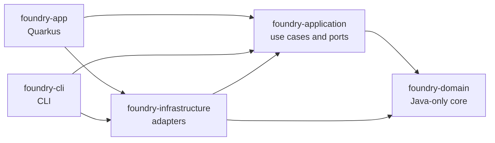

# Architecture

Microcks Foundry follows Clean Architecture. The domain and use cases form a Java-only core; adapters and entry points depend inward, never the other way around.

## Modules

| Module | Responsibility | Allowed dependencies |
| --- | --- | --- |
| `foundry-domain` | Domain model, rules, and algorithms | Java platform only |
| `foundry-application` | Use cases and ports | `foundry-domain` |
| `foundry-infrastructure` | Adapters for external systems and persistence | `foundry-application`, `foundry-domain` |
| `foundry-app` | Quarkus entry point and composition root | `foundry-application`, `foundry-infrastructure` |
| `foundry-cli` | CLI entry point and composition root | `foundry-application`, `foundry-infrastructure` |

The `foundry-app` and `foundry-cli` modules are composition roots. The CLI module is scaffolding until its command-line behavior is implemented.

## Enforced boundaries

ArchUnit tests in `foundry-app` verify that:

- the domain does not depend on application, infrastructure, either entry point, or Quarkus;
- application code does not depend on infrastructure, either entry point, or Quarkus;
- infrastructure does not depend on either entry point.

The rules run as part of `mvn verify` and are included in GitHub Actions pull request checks.

## Build baseline

- JDK and Java release: 21, configured by `maven.compiler.release` in the root `pom.xml` and matched by CI.
- Quarkus: `3.20.3`, configured once as `quarkus.platform.version` and used for both the platform BOM and Maven plugin.
- CI runner: `ubuntu-latest` Linux x86_64; the native job produces an executable for that runner architecture.
- Local native builds use the architecture of the container builder. Other operating systems and CPU architectures are not yet CI-supported.

See [CONTRIBUTING.md](CONTRIBUTING.md) for the build and validation commands.
